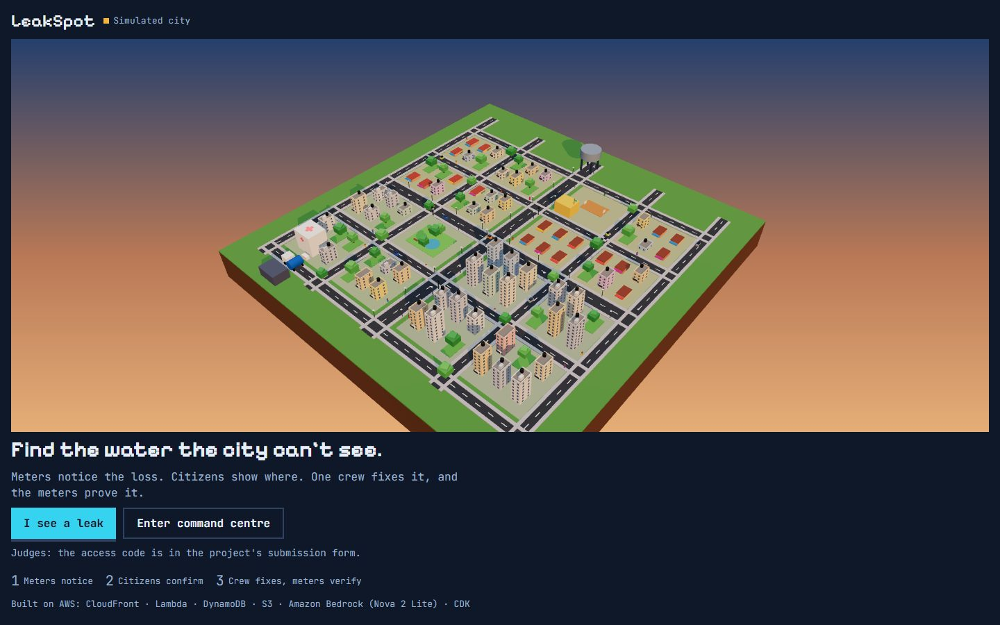
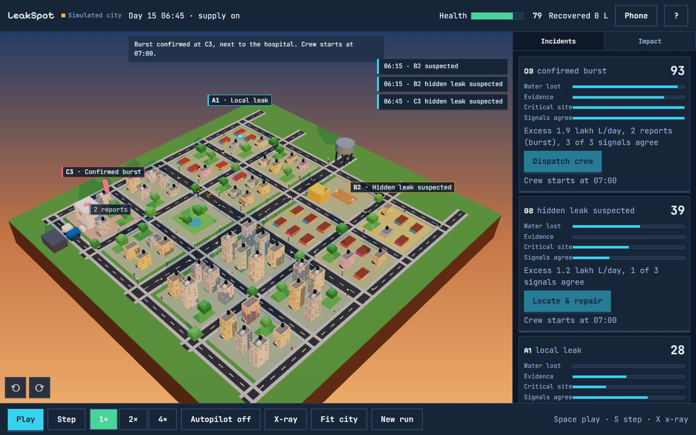
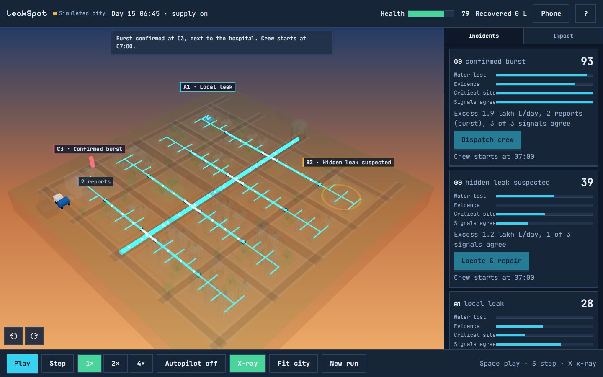
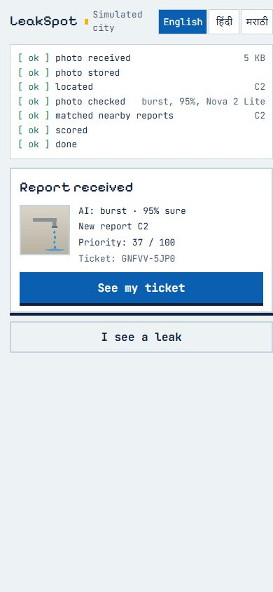
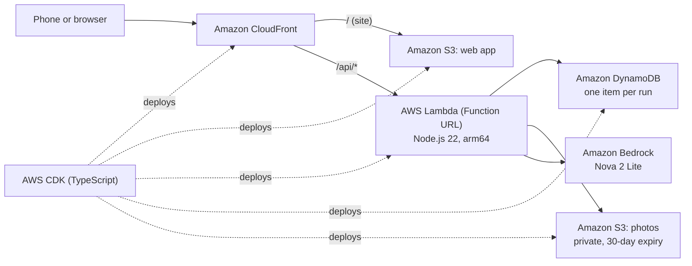

# LeakSpot

**Find the water the city can't see.** Building meters notice water going missing, citizens confirm
it with a phone photo checked by AI, a fixed score ranks the leaks, one crew fixes the top one, and
the meters prove the fix.

**[Live demo](https://d16l2tljxlr7ci.cloudfront.net)** · Demo video: link in the submission form ·
**Access code: in the submission form**



| Command Centre at 06:45                                                                                        | X-ray: the pipe network                                                         | Citizen report on a phone                                                               |
| -------------------------------------------------------------------------------------------------------------- | ------------------------------------------------------------------------------- | --------------------------------------------------------------------------------------- |
|  |  |  |

---

## The problem

Indian cities lose a large share of their treated water before it reaches a tap. Most of it leaks
underground, where nobody sees it. A burst on the road gets reported; a slow leak under a building
can run for months. Utilities have few crews, and they usually go wherever the last complaint came
from, not where the most water is being lost. And a job is "closed" when the crew leaves, not when
the loss actually stops.

LeakSpot tries a simple fix: let the meters say _where water is missing_, let citizens say _what it
looks like_, rank every leak with one transparent score, and only call a repair done when the
meters agree.

## How it works

```
meters notice  →  citizens confirm  →  a fixed score ranks  →  one crew fixes  →  meters verify
```

**1. Meters notice (water balance).** Every sector has an inlet meter, and every building has its
own meter. Inflow minus what the buildings used is _unaccounted water_. Each sector has a normal
level for each 15-minute slot of the day (median and MAD over the previous 14 days). A slot is
anomalous when **z ≥ 3 and the excess is ≥ 8 %**. **Two anomalous slots in a row** mark the sector
_suspected_. The detector only ever sees meter readings and reports, never where the simulation put
the leaks.

**2. Citizens confirm.** Anyone can open `/report` on a phone (or scan the QR code on the Command
Centre), take a photo and tap the spot. Amazon Bedrock (Nova 2 Lite) labels the photo: burst, major
leak, small drip, sewage in supply, not a leak. If the AI is unavailable, the report is kept as
_self-reported_ and still counts. "Low / no water" reports work without a photo.

**3. A fixed score ranks.** Reports near each other merge into one incident, and every incident
gets the same explainable score:

```
P = 40·W + 25·E + 20·C + 15·K        (0–100)
W  water lost        excess litres/day, capped at 2 lakh
E  evidence          photo severity and number of reports
C  critical site     hospital, school, trunk main, connections
K  signals agree     meters, reports and a confident photo
```

In the demo day, the burst next to the hospital in **C3 scores 96** (all four signals strong). The
hidden leak in **B2 scores 39**: real water loss, but no reports yet. Sewage in supply never scores
below 80.

**4. One crew fixes.** The crew goes to the highest score first. It drives over the street grid
from the depot and marks the repair.

**5. Meters verify.** A repair is **verified only after 3 clean slots** (excess back to ≤ 3 %).
Otherwise the incident reopens. "Closed" means the meters agree, not just that the crew left.

## Try it in 3 minutes

1. Open the **[live demo](https://d16l2tljxlr7ci.cloudfront.net)** and choose **Enter command
   centre**. Type the access code from the submission form.
2. Choose **Watch it work · 2 min** to see the whole day on autopilot with five short captions. Or
   choose **Run it yourself**, as below.
3. Press **Play** (or **Step**). At **06:15** B2 turns _suspected_: the meters see a loss nobody
   has reported. At **06:45** citizen photos confirm a burst at **C3**, next to the hospital.
4. Press **X-ray** (or the X key). The city fades, and the water network glows from the tower to
   every building.
5. At **07:00** the crew starts. Press **Dispatch crew** on C3 and watch the truck drive. When it is
   on site, press **Mark repaired**. About three slots later the meters verify it: **+1.8 lakh
   L/day recovered**.
6. Press **Phone** and scan the QR code (or open the link). On your phone choose **I see a leak**,
   take any photo, tap a spot and **Send**. The AI check appears on your phone and a new pin appears
   on the map.
7. Turn **Autopilot** on and **Play** to the end of the day for the **Day report**.

The "?" button in the top bar explains the loop at any time. The city, its meters and its leaks are
simulated. Your phone reports and the AI photo checks are real.

## Architecture



One Lambda serves the whole API and is **stateless**. Everything about a run (clock, sectors,
incidents, crew, reports) lives in one DynamoDB item, written with a version check so two requests
can never overwrite each other. The simulated city is rebuilt from a fixed seed on every request.

**One citizen photo, end to end**

1. The phone shrinks the photo to under 400 KB and strips location data (EXIF) before it leaves.
2. `POST /api/runs/{run}/reports` → Lambda stores the photo in the private S3 bucket and adds the
   report to the run (rate limit: 20 reports per 10 minutes per IP).
3. `POST …/classify` → Lambda sends the photo to Bedrock (Converse API) and gets a label and a
   confidence back. On failure the report is marked _self-reported_.
4. The engine merges the report with nearby ones, re-scores the incident, and saves the run.
5. The phone shows each step as it happens. The Command Centre picks up the new pin within
   3 seconds. Photos are only shown to the Command Centre, through 5-minute signed links.

## AWS services

| Service                              | What it does in LeakSpot                                                                 | Why                                                                              |
| ------------------------------------ | ---------------------------------------------------------------------------------------- | -------------------------------------------------------------------------------- |
| **Amazon CloudFront**                | Serves the site and routes `/api/*` to Lambda on one domain                              | HTTPS, caching, and no CORS between the site and the API                         |
| **Amazon S3**                        | Hosts the web app; stores citizen photos (private, 30-day expiry)                        | Cheap, durable, and the site bucket is reachable only through CloudFront         |
| **AWS Lambda**                       | The whole API: reports, AI checks, the simulation tick, crew actions                     | Pay per request, nothing to run between demos; arm64 for price                   |
| **Amazon DynamoDB**                  | One item per run with all its state, version-checked writes                              | On-demand, single-digit-millisecond reads, nothing to size or manage             |
| **Amazon Bedrock**                   | Nova 2 Lite labels each citizen photo                                                    | A managed multimodal model with no servers to run; billed only per photo checked |
| **AWS IAM**                          | Least-privilege roles: Lambda may only use its table, the `photos/` prefix and Nova Lite | Every permission is scoped to one resource                                       |
| **Amazon CloudWatch Logs**           | Lambda logs, kept for 7 days                                                             | Debugging without paying to keep old logs                                        |
| **AWS CloudFormation (via AWS CDK)** | Creates and updates everything above as one stack                                        | Repeatable deploys from code; nothing was built by hand                          |

## AWS open source used

- **[AWS CDK](https://github.com/aws/aws-cdk)** (TypeScript): the whole stack in `infra/`.
- **[AWS SDK for JavaScript v3](https://github.com/aws/aws-sdk-js-v3)**: DynamoDB, S3, presigned
  URLs and the Bedrock Runtime Converse API in `services/api`.
- **[AWS Labs MCP servers](https://github.com/awslabs/mcp)** (Documentation, Pricing, CDK): used
  while building, to check service limits, prices and CDK patterns.

## Tech stack

| Area                   | Choice                                                                             |
| ---------------------- | ---------------------------------------------------------------------------------- |
| Frontend               | React 19, React Router, TanStack Query, Vite 8, CSS modules (no UI kit)            |
| 3D city                | three.js 0.186 with react-three-fiber 9 and drei; hand-built instanced geometry    |
| Backend                | Node.js 22 on AWS Lambda (one function, Function URL), AWS SDK v3                  |
| Domain engine          | Pure TypeScript (`packages/core`): simulation, water balance, anomaly, score, crew |
| Validation             | zod 4 contracts shared by the web app and the API                                  |
| Testing                | Vitest (unit, API handler, component), Playwright (end to end), Testing Library    |
| Infrastructure as code | AWS CDK 2 (TypeScript), esbuild for the Lambda bundle                              |
| Language and tooling   | TypeScript 6 (strict), ESLint, Prettier, npm workspaces                            |

## Repository structure

```
apps/web/            React app: landing, Command Centre (3D city), citizen /report and tickets
services/api/        The Lambda API: router, handlers, DynamoDB, S3 and Bedrock adapters, local server
packages/core/       The domain engine: Jaldhara world, simulation, water balance, score, run reducer
packages/contracts/  zod request/response schemas shared by the web app and the API
infra/               AWS CDK stack: CloudFront, S3, Lambda, DynamoDB, IAM, logs
scripts/             build, dev, lint, typecheck, deploy and live smoke-test scripts
seed/                Seed manifest for the scripted demo reports
docs/                Architecture, design decisions (ADRs), costs, README images
```

## Run it locally

Requirements: Node.js 22 or newer.

```bash
npm install
# Pick any 8-character test code (letters A–Z except I L O U, digits 2–9) and give the API its SHA-256:
#   bash:        export COMMAND_CODE_SHA256=$(node -e "console.log(require('crypto').createHash('sha256').update('ABCDEFGH').digest('hex'))")
#   PowerShell:  $env:COMMAND_CODE_SHA256 = node -e "console.log(require('crypto').createHash('sha256').update('ABCDEFGH').digest('hex'))"
npm run dev
```

The web app runs on http://localhost:5173 and the API on http://localhost:8787 (in memory, with a
fake vision model, so no AWS account is needed). Enter `ABCDEFGH` at `/command`. Without
`COMMAND_CODE_SHA256` every command route is refused.

## Tests

```bash
npm run typecheck    # every workspace, strict TypeScript
npm run lint         # ESLint + Prettier
npm test             # Vitest: engine, API handlers, contracts, web components, CDK stack
npm run e2e -w @leakspot/web     # Playwright: health bar, access code (starts the dev stack)
```

The engine tests pin the demo day exactly (C3 96, B2 39, A1 31, D4 25; the B2 suspicion at 06:15,
the C3 confirmation at 06:45, verification at 08:15). A bundle test checks that no scripted leak
position ever reaches the browser.

## Deploy your own

You need an AWS account with Amazon Bedrock access to Nova 2 Lite, and AWS credentials for a named
profile. The stack is pinned to literal values so synthesis needs no credentials. Set your own
account id and region in `infra/bin/leakspot.ts` (and in the matching assertion in
`infra/test/leakspot-stack.test.ts`), and the same region in `scripts/aws-env.mjs`.

```bash
npm install
npx cdk bootstrap --profile <your-profile>          # once per account and region
cp .env.deploy.example .env.deploy                  # then set LEAKSPOT_COMMAND_CODE (8 characters)
LEAKSPOT_AWS_PROFILE=<your-profile> npm run deploy  # PowerShell: $env:LEAKSPOT_AWS_PROFILE="<your-profile>"; npm run deploy
```

`npm run deploy` builds everything and runs `cdk deploy LeakSpot` (it pauses for approval if IAM
permissions widen). It works on Windows, macOS and Linux. The stack stores only the SHA-256 of your
code; the plain code stays in `.env.deploy`, which git ignores. The site URL is printed at the end
and saved to `infra/cdk-outputs.json`. Check a deployment with
`npx tsx scripts/smoke.ts <site-url>`. The live demo runs in `ap-south-1` (Mumbai).

## Security and privacy

- **Command Centre access**: every command request carries the access code in a header, which the
  API hashes (SHA-256) and compares in constant time. If the stored hash is missing or invalid, the
  API refuses everything. The browser keeps the code only for the current tab (sessionStorage).
- **Citizen photos**: location data is stripped on the phone; photos sit in a private bucket, are
  shown only to the Command Centre through 5-minute signed links, and are deleted after 30 days.
- **Abuse limits**: 20 citizen reports per 10 minutes per IP, and a 400 KB photo limit checked on
  the server.
- **No secrets in the repository**: the deploy code lives in a git-ignored file; IAM permissions are
  scoped to single resources.

## Cost

Everything is serverless and on-demand: CloudFront, S3, Lambda, DynamoDB (pay per request) and
Bedrock (pay per photo checked). With no traffic it costs close to nothing. A demo day is a
few hundred Lambda calls and DynamoDB requests, much of which the AWS Free Tier can cover depending
on the account; the only real per-use cost is the Bedrock call for each photo. Details:
[docs/COSTS.md](docs/COSTS.md).

## Honesty notes

- **The city is simulated.** Jaldhara (16 sectors, one day from 06:00 to 20:00) is generated from a
  fixed seed, and the "Simulated city" label is always on screen. The leaks, meter readings and
  scripted citizen reports are simulated. **Phone reports and AI photo checks are real.**
- **The detector never sees where the leaks are.** It reads only meter readings and reports; the
  API never returns hidden leak positions, and a test checks the browser bundle for them.
- **AI is optional.** If Bedrock fails, the report is kept as _self-reported_ and still counts.
- Traffic, people and other street life in the 3D city are decoration, not data.

## Limitations and roadmap

- One simulated day and one crew. Next: several crews and multi-day runs.
- Meter data is simulated. Next: ingest real AMR/AMI meter feeds per district metered area.
- The score weights are fixed by design (explainable). Next: let a utility tune them per city, with
  an audit trail.
- English, Hindi and Marathi on citizen screens. Next: more Indian languages.
- Planned: a public stats page (runs, reports, litres recovered over time).

## Built with

Built solo for the hackathon (Heat and Water track) by **Soham Deshmukh**, with
**[Kiro](https://kiro.dev)** (spec-driven development: steering files, specs and hooks) and
**[Claude Code](https://claude.com/claude-code)**.

## License

[MIT](LICENSE) © 2026 Soham Deshmukh
