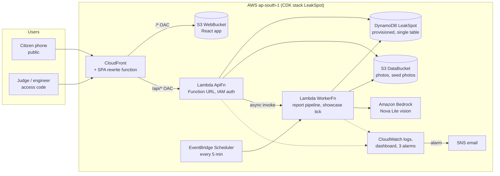

# Architecture

Kiro keeps this file current from CP1 onward. Starting point:

## Module map
| Layer | Package | Knows about | Never imports |
|---|---|---|---|
| Domain: simulator | packages/core/src/sim | ground truth (leaks, NPCs) | — |
| Domain: engine | packages/core/src/engine | readings, reports, actions | sim/ |
| Domain: run | packages/core/src/run | sim + engine, composes them | anything outside core |
| Contracts | packages/contracts | zod schemas | core, AWS |
| Use cases | services/api/src/app | ports, core, contracts | adapters, AWS SDK |
| Adapters | services/api/src/adapters | AWS SDK, memory, fakes | — |
| Web | apps/web | contracts, core (world data, counterfactual) | AWS SDK |

## Request flows
1. **Tick** (command or scheduler): read run META → `sim.generateSlot` → `engine.applySlot` → autopilot
   actions → conditional write META + TICK item → return state.
2. **Citizen report**: validate → store photo in S3 → put REPORT (stage `received`) → async invoke worker →
   202. Worker: `stored` → `located` → `classifying` (cache → quota → Bedrock) → `classified` → `matching`
   (engine merge/fusion on META with optimistic lock) → `scored` → `done`.
3. **Dispatch / repair**: command action → pure reducer → conditional write → new state.
