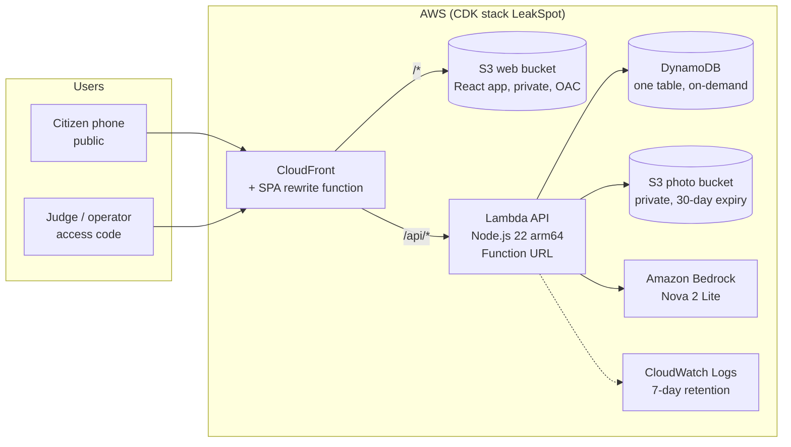

# Architecture

One CDK stack (`LeakSpot`, ap-south-1). Everything is serverless and on-demand.

- **CloudFront** serves the web app from the private S3 bucket (Origin Access Control) and routes
  `/api/*` to the Lambda Function URL, so the site and the API share one origin (no CORS). A small
  CloudFront Function rewrites app routes to `index.html`.
- **One Lambda** serves every API route. It is stateless: all runtime facts for a run live in one
  DynamoDB item, written with a version check (optimistic locking), and the simulated city is rebuilt
  from a fixed seed on each request.
- **Command routes** require the `x-leakspot-code` header; the Lambda compares its SHA-256 with the
  configured hash in constant time and denies everything if the hash is missing or invalid.
- **Photos** go to a private bucket and are shown to the Command Centre only through 5-minute
  presigned URLs; objects expire after 30 days.
- **Bedrock** is called synchronously per citizen photo (Converse API). If the call fails, the report is
  kept as _self-reported_ and still counts.

## Module map

| Layer             | Package                   | Knows about                                                                           | Never imports                        |
| ----------------- | ------------------------- | ------------------------------------------------------------------------------------- | ------------------------------------ |
| Domain: simulator | packages/core/src/sim     | ground truth (leaks, background traffic)                                              | —                                    |
| Domain: engine    | packages/core/src/engine  | readings, reports, actions                                                            | sim/                                 |
| Domain: run       | packages/core/src/run     | sim + engine, composes them                                                           | anything outside core                |
| Contracts         | packages/contracts        | zod schemas                                                                           | core, AWS                            |
| Use cases         | services/api/src/app      | ports, core, contracts                                                                | adapters, AWS SDK                    |
| Adapters          | services/api/src/adapters | AWS SDK, memory, fakes                                                                | —                                    |
| Web               | apps/web                  | contracts, `@leakspot/core/world` (layout, no leaks), `@leakspot/core/counterfactual` | AWS SDK, core root entry, sim/, run/ |

## Request flows

1. **Tick** (Play or Step in the Command Centre): read the run item → generate the next 15-minute slot
   of meter readings → engine: water balance, anomaly, incidents, score → autopilot actions if on →
   verification → conditional write of the run item → return the new state.
2. **Citizen report**: `POST /api/runs/{run}/reports` validates the body (photo ≤ 400 KB, JPEG), stores
   the photo in S3 and adds the report to the run (rate limit: 20 per 10 minutes per IP). Then
   `POST …/reports/{id}/classify` calls Bedrock, merges the report into a nearby incident or opens a new
   one, re-scores, and writes the run. The phone shows each real step in its PipelineLog.
3. **Dispatch / repair**: a command action runs a pure reducer on the run and writes it conditionally.
   A repair is verified only after 3 clean slots.
4. **Live sync**: while the Command Centre is paused it polls the run state every 3 seconds, so a phone
   report appears within seconds.

## History

An earlier design had a second "worker" Lambda for the report pipeline, an EventBridge Scheduler driving a
public showcase run, CloudWatch alarms with SNS email, and provisioned DynamoDB capacity. These were
removed before launch to keep one simple, synchronous path, and DynamoDB moved to on-demand
capacity because request volume is small.
